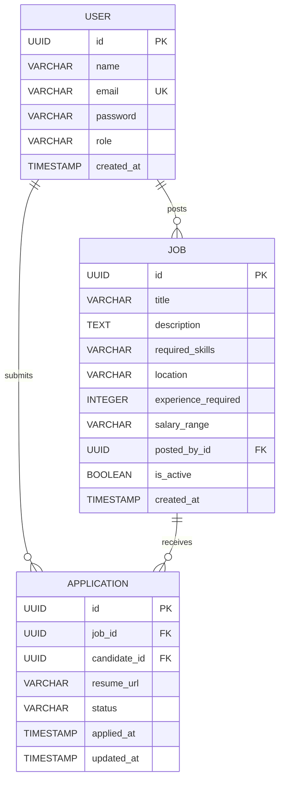

# Job Portal Backend REST API

A production-quality RESTful backend for a Job Portal application, built with Java 17 and Spring Boot 3.x. The project uses Spring Security with JWT (JSON Web Tokens) for authentication/authorization, Spring Data JPA with Hibernate for persistence, PostgreSQL as the primary database, and H2 database for unit and integration testing.

---

## 🛠️ Technology Stack

- **Core Framework**: Spring Boot 3.2.5
- **Language**: Java 17
- **Security**: Spring Security (JWT-based sessionless authentication)
- **Database**: PostgreSQL (Production), H2 (Testing)
- **ORM & Data**: Spring Data JPA + Hibernate
- **Build Tool**: Maven
- **Lombok**: Boilerplate reduction
- **Documentation**: SpringDoc OpenAPI 3.x (Swagger UI)
- **Validation**: Jakarta Bean Validation (`jakarta.validation`)

---

## 📂 Project Architecture & Package Structure

The project follows a standard layered architecture to maintain clear separation of concerns:

```
com.jobportal
├── config/             # Configuration classes (Security, Swagger, Multipart/Uploads)
├── controller/         # REST Controllers exposing the endpoints
├── dto/                # Data Transfer Objects
│   ├── request/        # Request payloads mapping and validation
│   └── response/       # Response payloads (including standard API wrapper)
├── entity/             # JPA Entities (User, Job, Application)
├── exception/          # Custom exceptions and Global Exception Handler
├── repository/         # Spring Data JPA repositories
├── security/           # JWT provider, security filter, and UserDetails service
├── service/            # Business logic interfaces and implementations
└── specification/      # Specifications for dynamic job search filtering
```

---

## 💾 Database Schema

The entity relationships are defined as follows:



### Constraints & Details:
- **User Role**: Enum (`CANDIDATE`, `RECRUITER`, `ADMIN`).
- **Application Status**: Enum with transition constraints:
  `APPLIED` ➔ `SHORTLISTED` / `REJECTED`
  `SHORTLISTED` ➔ `INTERVIEW` / `REJECTED`
  `INTERVIEW` ➔ `HIRED` / `REJECTED`
- **Soft Delete**: Jobs are not hard-deleted; instead, `isActive` is set to `false`, which hides them from candidates.
- **Uniqueness**: A candidate can apply to a specific job only once (enforced via unique constraint on `(job_id, candidate_id)`).

---

## 🚀 Getting Started

### 📋 Prerequisites
- **JDK 17** or higher
- **Maven** (bundled or installed)
- **PostgreSQL** (running locally or remotely)

### ⚙️ Database Configuration
Create a database named `jobportal` in PostgreSQL. 

Set database credentials and a strong JWT signing secret through environment variables. `JWT_SECRET` is required and must be at least 32 bytes for HS256. Never commit production secrets.
```bash
DB_URL=jdbc:postgresql://localhost:5432/jobportal
DB_USERNAME=your_username
DB_PASSWORD=your_password
JWT_SECRET=replace-with-a-random-secret-at-least-32-bytes-long
CORS_ORIGINS=http://localhost:5173
FILE_UPLOAD_DIR=./uploads/resumes
```

The application also supports `SERVER_PORT`, `JWT_EXPIRATION_MS`, `MAX_FILE_SIZE`, `MAX_REQUEST_SIZE`, and `LOG_LEVEL`.

### 🌐 Special DNS / Offline Setup
If your network environment restricts access to `repo.maven.apache.org` (causing DNS refusals), a custom `settings.xml` has been included in the project root to redirect dependencies through the `repo1.maven.org` mirror.
Run Maven commands by pointing to this settings file:
```bash
# Build the project using the custom settings.xml
mvn clean compile -s settings.xml

# Run the unit test suite
mvn test -s settings.xml
```

---

## 🐳 Run with Docker Compose

Prerequisites: Docker Desktop (or Docker Engine + Compose plugin).

1. Copy the environment template and edit the values:
   ```bash
   cp .env.example .env
   ```
2. Set strong values for `DB_PASSWORD` and `JWT_SECRET`. Generate a JWT secret with:
   ```bash
   openssl rand -base64 48
   ```
3. Start PostgreSQL and the Spring Boot API:
   ```bash
   docker compose up --build -d
   ```
4. Open Swagger UI at [http://localhost:8080/swagger-ui.html](http://localhost:8080/swagger-ui.html).

To inspect logs: `docker compose logs -f backend`. To stop: `docker compose down`. To stop and delete the database/uploads volumes as well: `docker compose down -v` (this permanently deletes persisted data).

Uploaded resumes and PostgreSQL data are stored in Docker-managed volumes. Keep the local `.env` file private; it is excluded from Git.

## 📝 API Endpoints & Authorization

All endpoints except authentication are prefix-protected and require the header `Authorization: Bearer <token>`.

| Method | Endpoint | Allowed Roles | Description |
| :--- | :--- | :--- | :--- |
| **POST** | `/api/auth/register` | Public | Register a new User (`CANDIDATE` or `RECRUITER`) |
| **POST** | `/api/auth/login` | Public | Authenticate and obtain JWT token |
| **POST** | `/api/jobs` | `RECRUITER` | Post a new job posting |
| **PUT** | `/api/jobs/{id}` | `RECRUITER` (Owner) | Update an existing job posting |
| **DELETE**| `/api/jobs/{id}` | `RECRUITER` (Owner) | Soft-delete a job posting (`isActive = false`) |
| **GET** | `/api/jobs` | Public | Search/filter jobs (paginated) |
| **GET** | `/api/jobs/{id}` | Public | View details of a specific job |
| **POST** | `/api/applications` | `CANDIDATE` | Apply to a job (accepts resume multipart file) |
| **GET** | `/api/applications/my` | `CANDIDATE` | View candidate's applications (dashboard) |
| **GET** | `/api/applications/job/{jobId}` | `RECRUITER` (Owner) | View applicants for a specific job |
| **PATCH**| `/api/applications/{id}/status` | `RECRUITER` (Owner) | Update application status with state-validation |
| **GET** | `/api/applications/{id}/resume` | Candidate owner or job-owning recruiter | Download a resume through an authorized endpoint |
| **GET** | `/api/recruiter/dashboard` | `RECRUITER` | Get recruiter dashboard stats (jobs + count) |
| **GET** | `/api/users` or `/api/admin/users` | `ADMIN` | Get list of all users |
| **GET** | `/api/users/{id}` or `/api/admin/users/{id}` | `ADMIN` | Get user profile details |

---

## 📦 Request/Response Examples

### 🔐 Authentication

#### 1. Register User (`POST /api/auth/register`)
**Request Body:**
```json
{
  "name": "Jane Doe",
  "email": "jane.doe@example.com",
  "password": "StrongPassword123",
  "role": "CANDIDATE"
}
```
**Response Body (201 Created):**
```json
{
  "success": true,
  "message": "User registered successfully",
  "data": {
    "token": "eyJhbGciOiJIUzI1NiJ9...",
    "tokenType": "Bearer",
    "userId": "d7b2783d-6bdf-4eb9-bf89-f538e1215bbf",
    "email": "jane.doe@example.com",
    "name": "Jane Doe",
    "role": "CANDIDATE"
  }
}
```

#### 2. User Login (`POST /api/auth/login`)
**Request Body:**
```json
{
  "email": "jane.doe@example.com",
  "password": "StrongPassword123"
}
```

---

### 💼 Jobs

#### 1. Create Job (`POST /api/jobs`)
**Headers:** `Authorization: Bearer <token>`
**Request Body:**
```json
{
  "title": "Senior Java Developer",
  "description": "We are looking for a Senior Java Developer with Spring Boot experience.",
  "requiredSkills": "Java, Spring Boot, PostgreSQL, Docker",
  "location": "Remote",
  "experienceRequired": 5,
  "salaryRange": "$100,000 - $130,000"
}
```

#### 2. Search Jobs with Filters (`GET /api/jobs?skill=Java&location=Remote&experience=6&page=0&size=10`)
**Response Body (200 OK):**
```json
{
  "success": true,
  "message": "Jobs retrieved successfully",
  "data": {
    "content": [
      {
        "id": "e9c20f18-6be0-449e-baef-c07a35368a12",
        "title": "Senior Java Developer",
        "description": "We are looking for a Senior Java Developer with Spring Boot experience.",
        "requiredSkills": "Java, Spring Boot, PostgreSQL, Docker",
        "location": "Remote",
        "experienceRequired": 5,
        "salaryRange": "$100,000 - $130,000",
        "recruiterName": "John Recruiter",
        "recruiterId": "a82b3d87-347b-4ea8-aa92-7f722a129f1b",
        "isActive": true,
        "createdAt": "2026-06-19T12:00:00"
      }
    ],
    "pageable": {
      "pageNumber": 0,
      "pageSize": 10
    },
    "totalPages": 1,
    "totalElements": 1,
    "last": true
  }
}
```

---

### 📄 Job Applications

#### 1. Submit Application (`POST /api/applications`)
**Headers:** `Authorization: Bearer <token>`
**Content-Type**: `multipart/form-data`
**Parts**:
- `jobId`: `e9c20f18-6be0-449e-baef-c07a35368a12`
- `resume`: `<binary_file>` (PDF, DOC, or DOCX; max size 10MB)

**Response Body (201 Created):**
```json
{
  "success": true,
  "message": "Application submitted successfully",
  "data": {
    "id": "3b2a1a8c-9c7b-4ea2-ab39-f9c98ba8b1c1",
    "jobId": "e9c20f18-6be0-449e-baef-c07a35368a12",
    "jobTitle": "Senior Java Developer",
    "candidateId": "d7b2783d-6bdf-4eb9-bf89-f538e1215bbf",
    "candidateName": "Jane Doe",
    "resumeUrl": "/api/applications/3b2a1a8c-9c7b-4ea2-ab39-f9c98ba8b1c1/resume",
    "status": "APPLIED",
    "appliedAt": "2026-06-19T15:45:00"
  }
}
```

#### 2. Update Application Status (`PATCH /api/applications/{id}/status`)
**Headers**: `Authorization: Bearer <token>`
**Request Body:**
```json
{
  "status": "SHORTLISTED"
}
```
**Response Body (200 OK):**
```json
{
  "success": true,
  "message": "Application status updated successfully",
  "data": {
    "id": "3b2a1a8c-9c7b-4ea2-ab39-f9c98ba8b1c1",
    "jobId": "e9c20f18-6be0-449e-baef-c07a35368a12",
    "jobTitle": "Senior Java Developer",
    "candidateId": "d7b2783d-6bdf-4eb9-bf89-f538e1215bbf",
    "candidateName": "Jane Doe",
    "resumeUrl": "/uploads/resumes/d7b2783d-6bdf-4eb9-bf89-f538e1215bbf_resume.pdf",
    "status": "SHORTLISTED",
    "appliedAt": "2026-06-19T15:45:00",
    "updatedAt": "2026-06-19T15:50:00"
  }
}
```

---

## ⚡ Exception & Validation Mapping

All errors are returned in a standard API wrapper JSON payload:
```json
{
  "success": false,
  "message": "Validation Failed",
  "data": {
    "email": "must be a well-formed email address",
    "password": "size must be between 6 and 20"
  }
}
```

Common status codes returned by the Global Exception Handler:
- `400 Bad Request`: Input validation failures or illegal application status state transitions.
- `401 Unauthorized`: Missing or malformed JWT token.
- `403 Forbidden`: Role check failures (e.g. Candidate posting a job) or ownership checks (e.g. Recruiter modifying another's job).
- `404 Not Found`: Resource (User, Job, or Application) does not exist.
- `409 Conflict`: Candidate trying to apply to the same job multiple times.


## 🤖 AI Career Tools

Candidate AI endpoints use OpenAI Chat Completions (default model: `gpt-4o-mini`). Configure `OPENAI_API_KEY` in the backend's private `.env` file. Never put this key in the frontend or commit it to Git. Resume text is extracted with Apache Tika, stored for the signed-in candidate, and sent to the configured AI provider for analysis and job matching. Uploads are limited to 10 MB and PDF, DOC, or DOCX. AI match scores are advisory and must not be used as automatic hiring decisions.

- `POST /api/candidate/ai/resume/analyze` — multipart field `resume`
- `GET /api/candidate/ai/job-matches` — requires a previously analyzed resume
